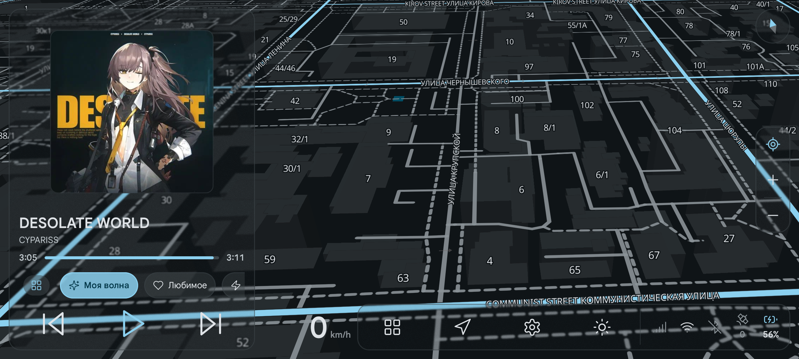
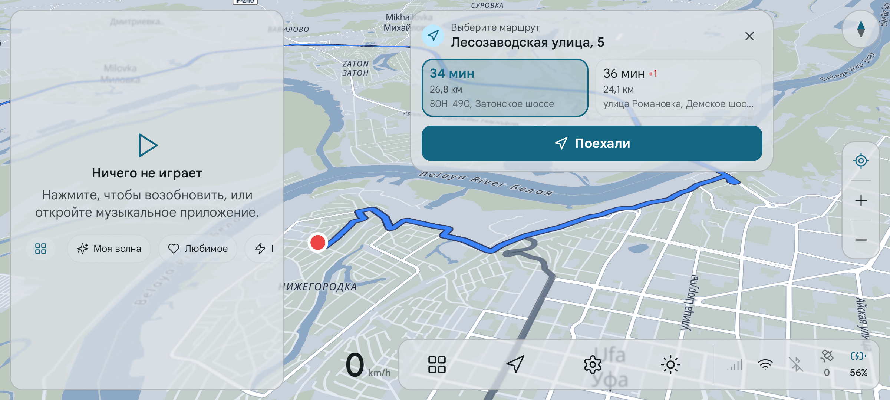

<div align="center">


# Femto Car Launcher RU (Русский интерфейс)

**Автомобильный Android лаунчер с русским интерфейсом, навигацией и Яндекс Музыкой.**  
*A glanceable in-car Android launcher with full Russian interface, navigation & Yandex Music.*

[](https://github.com/Liga1231/femto-car-launcher-ru/releases/latest)
[](README.md)
[-3DDC84?logo=android&logoColor=white)](https://developer.android.com)
[](https://music.yandex.ru)
[](CHANGELOG.md)

</div>

> [!NOTE]
форк автомобильного лаунчера с расширенным функционалом для головных устройств и планшетов на базе Android 10, 11 и 12 (API 29+). Полный подробный список изменений доступен в [**CHANGELOG.md**](CHANGELOG.md).
> 
> *A feature-rich automotive launcher fork optimized for head units and in-car tablets running Android 10, 11, and 12 (API 29+). Full detailed changelog is available in [**CHANGELOG.md**](CHANGELOG.md).*

<div align="center">



<p>&nbsp;</p>



<sub>Реальные скриншоты интерфейса Femto Car Launcher RU на устройстве: тёмная тема с 3D-зданиями и управлением Яндекс Музыкой (сверху) и светлая тема с навигацией и выбором маршрута (снизу).<br><i>Real device screenshots: Dark theme with 3D map & Yandex Music in-place player (top), Light theme with navigation & route selection (bottom).</i></sub>

</div>

---

## 🇷🇺 Нововведения и доработки (Russian)

* 🧭 **Встроенная навигация и планирование маршрутов:**
  * Интерактивное окно выбора маршрутов прямо на карте: несколько альтернативных вариантов (расчётное время, расстояние, название основных дорог) и кнопка «Поехали».
  * История недавних мест и поездок (Jetpack DataStore): автоматическое сохранение адресов, быстрый старт навигации в 1 тап, защита от дубликатов, удаление отдельных записей или полная очистка.
  * Полноценный голосовой и текстовый поиск адресов.
  * Работа карты и навигации онлайн по всему миру (OpenFreeMap, OSRM, Nominatim) с гибридной поддержкой офлайн-карт: при наличии файла .mbtiles (например, bashkortostan.mbtiles в /sdcard/Femto/maps/) лаунчер мгновенно и автономно отрисовывает векторную карту и ищет адреса офлайн.
* 🎛️ **Системный трей и управление яркостью в доке:**
  * Всплывающий системный трей при нажатии на статус-бар или кнопку дока: быстрый доступ к громкости, статусу сети и переключателям без вытягивания системной шторки Android, перекрывающей лаунчер.
  * Встроенный слайдер регулировки яркости прямо в доке для мгновенной подстройки подсветки экрана одним свайпом во время вождения.
* ☀️ **Сценарии автоматизации день/ночь:**
  * Автоматическое переключение дневной и ночной палитры на основе солнечного расписания (рассвет/закат по GPS-координатам).
  * Исправлен баг, при котором ночной режим карты не переключался обратно в дневной.
  * Комплексная синхронизация UI: автоматическая адаптация контрастности виджетов, яркости и подложки карты.
* 🎵 **Глубокая интеграция с Яндекс Музыкой (без переключения приложений):**
  * Встроенное меню выбора волн (BottomSheet): «Моя Волна», настроения («Бодрое», «Спокойное», «Радостное»), занятия («В дороге», «Тренировка») и жанры прямо на рабочем столе.
  * Виджет плеера с отображением обложки альбома в HD, названия трека, прогресс-баром и кнопкой «Любимое» (лайк).
  * Интерактивная пульсирующая неоновая анимация (Ripple Glow) вокруг кнопки волны при воспроизведении музыки.
* 🎨 **Схемы карты и оформление:**
  * 3 новые сбалансированные схемы карты: *Приглушённая (Muted)*, *Тёплая (Warm)*, *Грифельная (Slate)*.
  * Новые акцентные цвета интерфейса: `GRAPHITE`, `SLATE`, `WARM`.
  * Трёхмерные здания и рельеф местности с динамическим окрашиванием под выбранную тему.
* ⚡ **Оптимизация и аппаратная совместимость:**
  * Поддержка устройств с Android 10 (API 29) и Android 12 (API 31/32).
  * Оптимизация нагрузки на процессоры MediaTek (MTK) и GPU Mali (устранение микрофризов и оптимизация размытия Compose Haze).
  * Защита от случайного опускания шторки уведомлений Android.
  * Скрипты контроля уровня заряда батареи (Root Battery Limiter) для защиты аккумулятора от деградации и вздутия при постоянном питании в автомобиле.
  * Очистка репозитория от тяжелых бинарных файлов и мусора.
* 🛡️ **Нужны ли Root-права (Magisk / SuperSU)?**
  * **Лаунчер полностью работает БЕЗ Root-прав** — карты, навигация, виджеты, сценарии, слайдер яркости и Яндекс Музыка работают на любом стандартном устройстве из коробки.
  * **Root-права строго опциональны** и используются исключительно для системных функций:
    * Прямое аппаратное переключение Wi-Fi, Bluetooth, мобильных данных и GPS в системном трее без перехода в стандартные настройки Android.
    * Кнопки перезагрузки (Reboot) и выключения устройства (Power Off) прямо из шторки лаунчера (защищены диалогом подтверждения и блокируются во время движения).
    * Аппаратная блокировка выпадания стандартной шторки Android (`cmd statusbar collapse`).
    * На устройствах без Root эти действия безопасно игнорируются, не вызывая ошибок или сбоев приложения.

---

## 🇬🇧 Key Highlights and Features (English)

* 🧭 **In-App Navigation & Route Planning:**
  * Interactive route selection dialog directly on the map: multiple route alternatives (estimated time, distance, highway labels) with a one-tap "Go / Start" action.
  * Persistent destination & search history (Jetpack DataStore): automatic destination logging, quick 1-tap navigation start, smart deduplication, individual item deletion, and clear all.
  * Integrated voice and text destination search.
  * Global online map and navigation powered by OpenFreeMap, OSRM, and Nominatim, with hybrid offline support: automatically loads local .mbtiles vector maps and offline search when map archives are present on device storage (/sdcard/Femto/maps/).
* 🎛️ **In-App System Tray & Dock Brightness Slider:**
  * Pop-up system tray on status-bar or dock tap: quick access to volume, connectivity status, and toggles without pulling down the disruptive native Android notification shade.
  * Quick screen brightness slider integrated directly into the dock for instant on-the-fly backlight adjustments while driving.
* ☀️ **Solar Driving Scenarios & Day/Night Automation:**
  * Automatic day/night style transitions based on astronomical solar calculations (sunrise/sunset by GPS).
  * Fixed upstream bug where nighttime map styling failed to switch back to daytime styling after sunrise.
  * Full UI synchronization: automated adaptation of map colors, card contrast, and backlight at dusk and dawn.
* 🎵 **Deep Yandex Music Integration (No App Switching):**
  * In-launcher Vibe & Mood bottom sheet selector: "My Vibe", moods (Energetic, Calm, Cheerful), activities (Driving, Workout), and music genres without opening the external app.
  * Home screen media player card with HD album art, track/artist metadata, seekable progress bar, and instant "Favorite" (like) button.
  * Pulsating Ripple Glow neon ring animation around the vibe button synced with music playback.
* 🎨 **Custom Map Schemes & Visual Themes:**
  * 3 new balanced map color schemes: *Muted* (low eye-strain), *Warm* (gentle automotive lighting), and *Slate* (premium graphite dark tone).
  * New cohesive accent colors: `GRAPHITE`, `SLATE`, and `WARM`.
  * Dynamic 3D buildings and elevation relief shader recoloring synced with the active theme.
* ⚡ **Performance & Hardware Optimizations:**
  * Full support for Android 10 (API 29) and Android 12 (API 31/32) head units and tablets.
  * MediaTek (MTK) chipset and Mali GPU performance profiling: eliminated UI stutter and optimized heavy Gaussian blurs.
  * Notification shade pull-down guard preventing accidental Android system panel expansion.
  * Battery longevity management scripts (Root Battery Limiter) preventing battery swelling under continuous in-vehicle charging.
  * Purged repository from legacy APK binaries and temporary build clutter.
* 🛡️ **Are Root Permissions (Magisk / SuperSU) Required?**
  * **The launcher runs completely WITHOUT Root** — maps, in-app navigation, media controls, Yandex Music, widgets, solar scenarios, and brightness adjustments work out-of-the-box on standard unrooted devices.
  * **Root permissions are strictly optional** and only used for advanced system management:
    * Direct privileged hardware toggles for Wi-Fi, Bluetooth, Mobile Data, and GPS from the quick settings panel without redirecting to system settings.
    * Privileged Reboot and Power Off actions inside the system tray (protected by confirmation dialogs and motion-gated while driving).
    * Enforced status-bar / notification shade pull-down lockdown (`cmd statusbar collapse`).
    * On unrooted devices, these actions gracefully degrade with zero crashes or errors.

---

Femto Car Launcher replaces the Android home screen with a single fixed dashboard designed for automotive viewing distances and touch accuracy. The dashboard combines a live map, driving data, weather, calendar, and media control on one screen, so you read the essentials at a glance instead of switching between apps.

Femto Car Launcher targets three hardware classes: aftermarket CarPlay / Android Auto AI boxes that inject Android into a factory display, Android head units (aftermarket units installed in the dashboard), and car-mounted phones. On a phone the launcher also runs as a regular app; making it the default home screen stays optional. The minimum supported platform is Android 10, which is Application Programming Interface (API) level 29 (compatible with Android 10, 11, 12, 13+). No single market is privileged: language, units, and locale-specific behavior adapt per device.

The [project site](https://seijikohara.github.io/femto-car-launcher/) describes each feature, carries the install guide, and hosts a screenshot catalog of the dashboard across display geometries, display sizes, themes, driver sides, and dock positions.


## Live map

The dashboard background is a live map that fills the whole display and follows the vehicle.

- **Two map providers.** OpenStreetMap data rendered through the keyless OpenFreeMap service works without an account or an API key. A Google Maps provider (roadmap, satellite, hybrid, and terrain map types with a traffic overlay) activates when you enter a personal Google Maps Platform API key in **Settings → Map**. Usage of this paid provider bills your own Google Cloud account; Femto Car Launcher adds no fees. The Google Maps provider is not offered in the territories on Google's [Prohibited Territories](https://cloud.google.com/maps-platform/terms/maps-prohibited-territories) list; see the [Terms of Service](TERMS.md). The default OpenStreetMap provider is unaffected.
- **Bring your own style.** The OpenStreetMap provider can load a hosted MapLibre style you name (**Settings → Appearance → Map color → Custom style URL**), including a style whose provider key is part of the URL. The map then shows that style's own credits. To use a mirror of the default provider's tile layout instead, set **Settings → Map → Tile host (advanced)**.
- **A car-navigation camera.** The camera follows the Global Positioning System (GPS) position with easing and keeps the direction of travel pointing up (heading-up). A tap on the compass toggles a north-up mode. A drag detaches the camera for free panning. The camera re-attaches automatically after a pause, or immediately when you tap the locate button. Zoom buttons and a compass sit at the screen edge, within reach of the driver.
- **Depth and style.** Optional three-dimensional (3D) buildings and terrain relief add depth on the OpenStreetMap provider. Map colors can follow the launcher accent color and the light/dark theme, or use the provider's own styles.
- **Automatic recovery.** When the map fails to load (an unstable link, a provider outage, a missing key), a notice appears in the visible map area. While the launcher is on screen, reloads retry with a capped backoff until the map data loads, even while the device still reports a connection. A reconnect after an offline period reloads the map at once. A refusal from the provider, such as a style address its server reports as missing or a rejected key, stops the retries after a few attempts. A failure with no readable answer, such as a server name that does not resolve, keeps retrying like an outage.

## Driving data and trips

- **Speed overlay.** The overlay shows current speed, trip distance, average speed, and altitude in high-contrast numerals, plus the reverse-geocoded address of the current position. A tap on the reset button starts a new trip and shows a "Since" timestamp.
- **Trip recording.** An on-device track log records the route at one fix per second while driving, with a configurable retention period. Recorded trips export as GPS Exchange Format (GPX) files through the system file picker.
- **Trip flythrough.** A tap on the speed panel opens a 3D wireframe replay of the recorded track, with a speed-colored trail and an altitude curtain, rendered natively. Devices without the required graphics support get a two-dimensional replay of the same track.

## Glanceable panels

- **Weather.** Current conditions, feels-like temperature, wind, and humidity from the Norwegian Meteorological Institute (MET Norway), with an hourly strip on the card and a full-screen panel built around a 24-hour temperature curve, precipitation nowcast, and daily range bars. Forecasts stay readable offline through an on-device cache.
- **Calendar.** A multi-day strip plus upcoming events read from the device calendar, with per-calendar visibility selection and a full-screen agenda panel. Event colors match the calendar colors.
- **Now playing.** The active media session of any app that publishes one: title, artist, album, cover art, and transport controls, including shuffle and repeat where the source app supports them. Cover art opens a full-screen player. Long titles scroll only while the vehicle is parked and truncate while it moves. A spectrum visualization renders on devices whose audio stack supports capture.
- **Video window.** An optional small window over the map plays a video file you pick from the device or USB storage, with a full-screen player. The picture stays hidden until GPS reads the vehicle as stopped; the audio keeps playing.
- **Clock.** A clock that follows the system 12/24-hour preference by default, with optional seconds.
- **Status cluster.** Wi-Fi and cellular signal, Bluetooth state, GPS reception, and battery level with charging state, shown in the dock.

## Apps and voice

- **Dock.** An application dock attaches to any screen edge. A long-press edits the dock: buttons and status icons reorder or hide individually, and a reset restores the default layout.
- **Destinations.** The dock's navigation button opens a destination panel: type or speak a place, or tap a saved one, and the launcher hands it to your navigation app. Typing, saving, and deleting pause while GPS reads the vehicle as moving; voice and a tap on a saved place work at any time.
- **App panel.** A full-screen application panel offers search, a pinned-apps row, recently used apps, an A–Z fast-scroll index, and three icon-size presets. A long-press on an app opens App info or uninstalls the app.
- **Voice assistant.** A microphone button captures speech in the launcher with a live transcript. The launcher falls back to the system voice assistant when no on-device recognizer exists or when you deny the microphone permission.

## Automotive defaults and adjustments

Automotive defaults keep the dashboard legible and operable while driving. At the default display size, body text stays at or above 16 scale-independent pixels (sp), and touch targets stay at or above 64 density-independent pixels (dp). The **Settings → Screen → Driver side** setting (Left or Right) anchors the cards, the clock, and the map controls on the driver's side of the screen, within reach. Each item below is a setting you can change, not a lockout:

- **Layout.** Landscape and portrait orientations, at aspect ratios from wide head units to car-mounted phones in portrait; the dashboard reflows across a matrix of screen sizes. Display size offers five steps from Small to Large. Small and Compact scale the whole interface below the default, so text and touch targets drop below the minimums above to fit more on screen.
- **Appearance.** Material You dynamic color by default, fixed accent presets as an alternative, a light/dark/automatic theme, and a configurable glass look (blur, borders, drop shadows) for the floating cards.
- **Typography.** The system font by default, any Google Fonts family per slot (a Latin face plus a Chinese-Japanese-Korean fallback face) downloaded on demand, or a font already installed on the device. Text size, weight, and letter spacing are adjustable. No fonts ship inside the Android package (APK), and no Play Services are required.
- **Animation.** The **Settings → Screen → Motion** setting (Standard, Reduced, Off) reduces or turns off animations.
- **Panels.** Calendar, weather, and music cards toggle individually, and the calendar card can show only the date, weekday, and month; the music card's spectrum, album name, and cover art each have a visibility switch, and the optional video window has its own switch and picture gate.
- **Units.** Speed, temperature, and clock format default to Auto, which follows the system settings; **Settings → Units** sets each one explicitly.

When a permission is denied or a data source is unavailable, the affected panel renders a reduced state instead of an error screen.

The dashboard layout does not change with vehicle motion, and the launcher has no driving lockout. A few features gate themselves on motion instead. The video window's picture stays hidden until GPS reads the vehicle as stopped. Destination typing, saving, and deleting, long music-title scrolling, the update prompt, and starting an install pause while GPS reads the vehicle as moving. An install confirmation already on screen still accepts an answer.

## Privacy and data

- Femto Car Launcher requires no account and contains no advertising and no analytics.
- Calendar and media data, saved destinations, and the reference to a video file you pick for the video window stay on the device.
- Location leaves the device only inside requests to the services you use: map tiles from the chosen map provider, weather from MET Norway, and reverse-geocoding queries when you configure a self-hosted geocoding host. The default reverse geocoder runs on the device.
- You enter Google Maps keys yourself. The app sends a key only to Google and keeps it on the device, apart from your own Android settings backup and device transfer; see the [Privacy Policy](PRIVACY.md).
- The app uses notification access, when you grant it, only to read and control the active media session for the now-playing card.
- An in-app diagnostics report (**Settings → System → Diagnostics**) summarizes device and runtime facts for troubleshooting. **Settings → System → Open source licenses** lists every bundled third-party component.
- The app's own terms are in the [Terms of Service](TERMS.md), also reachable in the app from **Settings → System → Terms**.

## Installation

Femto Car Launcher RU is distributed as standalone release-signed APKs:

- **Release APK**: download `femto-car-launcher-ru.apk` from the latest [GitHub release](https://github.com/Liga1231/femto-car-launcher-ru/releases/latest).
- Install the APK by sideloading on the device, or from a computer via Android Debug Bridge (ADB):
  ```bash
  adb install -r femto-car-launcher-ru.apk
  ```
- Supported Android versions: **Android 10, 11, 12, 13+ (API level 29+)**. Both 32-bit (`armeabi-v7a`) and 64-bit (`arm64-v8a`) automotive devices are supported.

## Building from source

The build needs a Java Development Kit (JDK) 21/25, the Android SDK, and an Android 10+ device or emulator. The Gradle build provisions Node.js and pnpm on demand for the bundled map page.

```bash
./gradlew assembleStableDebug   # debug APK at app/build/outputs/apk/stable/debug/
./gradlew assembleStableRelease # release APK at app/build/outputs/apk/stable/release/
```

## License

Femto Car Launcher is licensed under the Apache License, Version 2.0 ([`LICENSE`](LICENSE)). Bundled third-party components keep their own licenses, listed in the app under **Settings → System → Open source licenses**.
